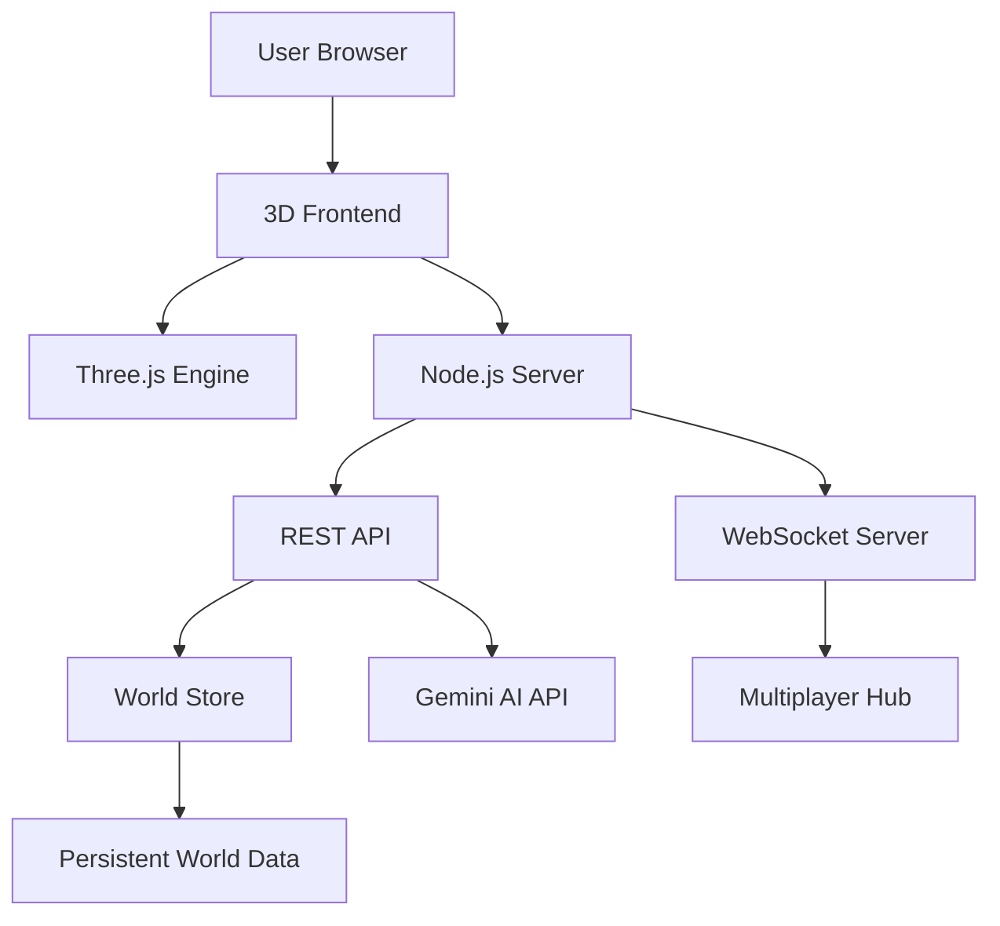

<div align="center">

# 🏝️ SUDHAN ISLAND

### Explore Beyond Imagination.

**A living 3D voxel island where creativity meets AI.**

Build your world. Explore new possibilities. Create anything.

[](https://github.com/Sudhan-2603/Sudhan-Island)
[](https://github.com/Sudhan-2603/Sudhan-Island/issues)
[](https://github.com/Sudhan-2603/Sudhan-Island/stargazers)

</div>

---

## 🌍 About

**Sudhan Island** is an interactive browser-based 3D voxel world powered by Three.js, Node.js and AI technologies.

Explore a beautiful virtual island, customize your character, interact with other players, and transform your imagination into 3D creations.

Whether you're exploring the environment, creating objects with AI, or connecting with other visitors, Sudhan Island brings creativity and technology together in one interactive experience.

> A world where imagination becomes reality.

---

## ✨ Features

<details open>
<summary><b>🌳 Interactive 3D World</b></summary>

- Beautiful voxel-based environment.
- Real-time 3D rendering.
- Interactive world elements.
- Explore a dynamic island.
- Smooth camera movements.

</details>

<details>
<summary><b>🎮 Camera & Controls</b></summary>

- Orbit camera.
- Pan camera.
- First-person walking mode.
- Camera recentering.
- Mobile touch joystick.

</details>

<details>
<summary><b>🤖 AI-Powered Creation</b></summary>

- Generate 3D creations using AI.
- Describe objects using natural language.
- Upload images as creation inputs.
- Gemini API integration.
- Create and place objects inside the world.

</details>

<details>
<summary><b>👥 Multiplayer</b></summary>

- Shared world interactions.
- Real-time player synchronization.
- Character customization.
- WebSocket communication.
- HTTP synchronization fallback.

</details>

<details>
<summary><b>📱 Responsive Experience</b></summary>

- Desktop support.
- Mobile-friendly controls.
- Touch interactions.
- Responsive interface.

</details>

---

## 🛠️ Tech Stack

| Technology | Purpose |
|---|---|
| Three.js | 3D rendering engine |
| JavaScript | Frontend development |
| TypeScript | Backend development |
| Node.js | Server runtime |
| Vite | Development and build |
| React | UI framework |
| Google Gemini | AI integration |
| WebSocket | Multiplayer communication |

---

## 🏗️ Architecture



---

## 📂 Project Structure

```text
Sudhan-Island/
│
├── client/
│   ├── app.js
│   ├── character_builder.js
│   ├── multiplayer_client.js
│   └── voxel/
│
├── public/
│
├── src/
│   ├── content_policy.ts
│   ├── env_types.ts
│   ├── live_feeds.ts
│   ├── minigame_ai.ts
│   ├── multiplayer_hub.ts
│   ├── security.ts
│   └── world_store.ts
│
├── index.html
├── index.css
├── server.ts
├── package.json
├── tsconfig.json
├── vite.config.ts
└── .env.example
```

---

## 🚀 Getting Started

### Prerequisites

- Node.js 22 or compatible version
- npm
- Git
- Google Gemini API key (for AI features)

### 1. Clone Repository

```bash
git clone https://github.com/Sudhan-2603/Sudhan-Island.git
```

### 2. Navigate to Project

```bash
cd Sudhan-Island
```

### 3. Install Dependencies

```bash
npm install
```

### 4. Configure Environment

Create your Gemini API key:

https://aistudio.google.com/apikey

**Windows PowerShell**

```powershell
$env:GEMINI_API_KEY="YOUR_API_KEY"
```

**Linux / macOS**

```bash
export GEMINI_API_KEY="YOUR_API_KEY"
```

### 5. Start Development

```bash
npm run dev
```

### 6. Open Application

```text
http://localhost:3000
```

---

## 🔐 Environment Variables

| Variable | Description |
|---|---|
| `GEMINI_API_KEY` | Gemini API authentication |
| `CREATOR_HMAC_SECRET` | Creator security secret |
| `HYDROGEN_MODEL` | Hydrogen model |
| `HYDROGEN_MODELS` | Hydrogen model configuration |
| `ARGON_MODEL` | Argon model |
| `FALLBACK_MODEL` | Fallback AI model |
| `MINIGAME_MODEL` | Minigame AI model |
| `WORLD_STATE_PATH` | Persistent world data location |
| `PORT` | Application server port |

**Security:** Never expose API keys in frontend code or commit `.env` files to GitHub.

---

## ☁️ Deployment

### Deploy using Render

Sudhan Island requires a Node.js backend. Deploy it as a **Web Service**, not as a static website.

**Step 1 — Push to GitHub**

```bash
git add .
git commit -m "Prepare for deployment"
git push origin main
```

**Step 2 — Open Render**

https://render.com/

- Sign in with GitHub.
- Select New Web Service.
- Connect your Sudhan-Island repository.
- Select the `main` branch.

**Step 3 — Build Configuration**

| Setting | Value |
|---|---|
| Runtime | Node |
| Build Command | `npm install && npm run build` |
| Start Command | `npm start` |

**Step 4 — Environment Variables**

Configure the following in Render:

```env
GEMINI_API_KEY=your_api_key
CREATOR_HMAC_SECRET=your_secure_secret
WORLD_STATE_PATH=/var/data/world.json
```

Attach a persistent disk mounted at `/var/data` if you use this world-state path.

**Step 5 — Deploy**

Click **Deploy Web Service**.

Your application will receive a public URL:

```text
https://your-sudhan-island.onrender.com
```

**Important deployment notes:**

- Ensure your server listens on `process.env.PORT`.
- Bind the server to `0.0.0.0`.
- Verify WebSocket support.
- Configure persistent storage for world data.
- Keep Gemini API credentials server-side.
- Check that your production build and start scripts work before deployment.

---

## 🔌 API Endpoints

| Endpoint | Method | Description |
|---|---|---|
| `/api/world` | GET | Retrieve world state |
| `/api/build` | POST | AI creation |
| `/api/job` | GET | Creation job status |
| `/api/feeds` | GET | Live feeds |
| `/api/audit` | GET | World audit |
| `/api/eta` | GET | Build diagnostics |
| `/api/mp` | POST | Multiplayer synchronization |
| `/ws` | WebSocket | Real-time multiplayer |

---

## 🧪 Production Build

Build the application:

```bash
npm run build
```

Start production:

```bash
npm start
```

---

## 🤝 Contributing

Contributions, ideas and improvements are welcome!

1. Fork this repository.
2. Create a new feature branch.
3. Make your changes.
4. Test your implementation.
5. Submit a Pull Request.

```bash
git checkout -b feature/new-feature
git add .
git commit -m "Add new feature"
git push origin feature/new-feature
```

---

## 🔒 Security

- Protect API credentials.
- Never commit private environment files.
- Validate uploaded files.
- Use secure production connections.
- Follow responsible API usage.

---

## 📜 License

See the repository's `LICENSE` file for applicable licensing terms.

---

<div align="center">

## ⭐ Support Sudhan Island

If you like this project, consider giving it a star on GitHub!

[](https://github.com/Sudhan-2603/Sudhan-Island)

**Made with ❤️, creativity and code.**

### 🏝️ Sudhan Island

*Build. Explore. Create. Connect.*

</div>
